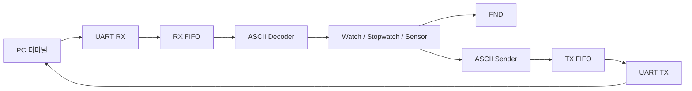

# UART 센서 제어 시스템 구조

## 담당 범위와 주요 파일

UART RX/TX, FIFO RX/TX, ASCII Decoder/Sender와 시스템 통합을 담당한 팀 프로젝트입니다. 센서·시계·표시부를 포함한 통합 소스를 함께 보존했습니다.

- `rtl/top_final.v`: 통신부와 기능부 통합
- `rtl/top_uart.v`, `rtl/uart.v`: UART와 FIFO 연동
- `rtl/ascii_decoder.v`: 문자 명령을 제어 신호로 변환
- `rtl/ascii_sender.v`: 데이터를 ASCII 출력으로 구성
- `rtl/fifo.v`: 순환 버퍼
- `tb/`: UART, FND, 초음파·온습도 센서 테스트벤치

## 문제 해결 경험

명령 디코더의 상태 전이 지연을 조합논리 구조로 변경하고, 문자열 생성과 송신 제어의 중복 구동을 분리했습니다. FIFO 포인터·리셋 조건과 센서 하드웨어 이상도 구분하여 점검했습니다.

## 통신 설정

9600/115200bps 중 하나를 근거 없이 확정하지 않고 현재 제출 RTL의 분주 파라미터를 확인하도록 안내합니다. PC 터미널과 RTL은 같은 baud·데이터·정지 비트 설정을 사용해야 합니다.
